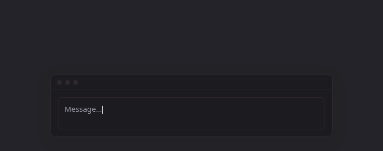

# alessa-voice

Local voice dictation for KDE Plasma (Wayland): press a key, talk, press it again, and the text is pasted at your cursor.



While you talk, a voice box at the top of the screen follows your voice; playing media is turned down until the text is pasted. Transcription runs on your own GPU with [whisper.cpp](https://github.com/ggml-org/whisper.cpp); nothing leaves the machine.

Website: https://to1un.github.io/alessa-voice/

## Requirements

- KDE Plasma 6 on Wayland
- A GPU with Vulkan (whisper.cpp built with the Vulkan backend)
- `python-pyqt6`, `layer-shell-qt`, `whisper-cpp`, `libpulse`, `pipewire`, `wl-clipboard`, `ydotool`

## Install

On Arch / CachyOS:

```bash
sudo pacman -S python-pyqt6 layer-shell-qt whisper-cpp libpulse pipewire wl-clipboard ydotool
systemctl --user enable --now ydotool
```

`ydotool` needs write access to `/dev/uinput` (the `input` group or a udev rule).

Download the models:

```bash
mkdir -p ~/.local/share/whisper/vad
curl -L -o ~/.local/share/whisper/ggml-large-v3.bin https://huggingface.co/ggerganov/whisper.cpp/resolve/main/ggml-large-v3.bin
curl -L -o ~/.local/share/whisper/vad/ggml-silero-v5.1.2.bin https://huggingface.co/ggml-org/whisper-vad/resolve/main/ggml-silero-v5.1.2.bin
```

Install alessa-voice:

```bash
git clone https://github.com/to1un/alessa-voice ~/projects/alessa-voice
ln -s ~/projects/alessa-voice/alessa_voice.py ~/.local/bin/alessa-voice
```

In *System Settings → Keyboard → Shortcuts → Add New → Command*, bind `alessa-voice toggle` (e.g. F8) and `alessa-voice cancel` (e.g. Ctrl+F8). Add `alessa-voice` to *Autostart*.

## Usage

| Command | |
|---|---|
| `alessa-voice` | run the daemon |
| `alessa-voice toggle` | start / stop recording |
| `alessa-voice cancel` | discard the recording |
| `alessa-voice models` | list local models |

Settings are in `~/.config/alessa-voice/config.toml`, created on first run. The default language is Turkish (`language = "tr"`); set `"en"` or `"auto"`. Other settings: model, recording limit (60 min) and warning, media volume while recording, position, sounds.

The last recording is kept in `~/.cache/alessa-voice/last.wav` until the next one.

## License

MIT
