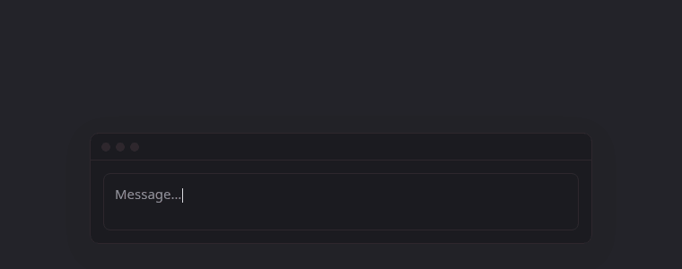

# alessa-voice

Voice dictation for KDE Plasma (Wayland): press a key, talk, press it again, and the text is pasted at your cursor.



While you talk, a frameless wave overlay (`Organik Dalga`) follows your voice and playing media is turned down until the text is pasted. Transcription runs via Groq Whisper with optional LLM cleanup/translation and a one-shot local `whisper-cli` fallback.

## Requirements

- KDE Plasma 6 on Wayland
- `python-pyqt6`, `layer-shell-qt`, `ffmpeg`, `pipewire`, `wireplumber`, `wl-clipboard`, `ydotool`
- Optional for local STT / fallback: `whisper-cpp` (with Vulkan)

## Install

On Arch / CachyOS:

```bash
sudo pacman -S python-pyqt6 layer-shell-qt ffmpeg pipewire wireplumber wl-clipboard ydotool
systemctl --user enable --now ydotool
```

`ydotool` needs write access to `/dev/uinput` (the `input` group or a udev rule).

Set `GROQ_API_KEY` in `~/.config/alessa/api-keys.env` (or in your environment). For local STT or offline fallback, install `whisper-cpp` and download the models:

```bash
mkdir -p ~/.local/share/whisper/vad
curl -L -o ~/.local/share/whisper/ggml-large-v3.bin https://huggingface.co/ggerganov/whisper.cpp/resolve/main/ggml-large-v3.bin
curl -L -o ~/.local/share/whisper/ggml-distil-large-v3.bin https://huggingface.co/distil-whisper/distil-large-v3-ggml/resolve/main/ggml-distil-large-v3.bin
curl -L -o ~/.local/share/whisper/vad/ggml-silero-v5.1.2.bin https://huggingface.co/ggml-org/whisper-vad/resolve/main/ggml-silero-v5.1.2.bin
```

Install alessa-voice:

```bash
git clone https://github.com/to1un/alessa-voice ~/workspace/alessa-voice
ln -s ~/workspace/alessa-voice/alessa_voice.py ~/.local/bin/alessa-voice
```

In *System Settings → Keyboard → Shortcuts → Add New → Command*, bind `alessa-voice toggle en` (`F6`), `alessa-voice toggle tr` (`F7`), `alessa-voice toggle to-en` (`F8`), and `alessa-voice cancel` (`Ctrl+F6` / `Ctrl+F7` / `Ctrl+F8`). Add `alessa-voice` to *Autostart*.

## Usage

| Command | |
|---|---|
| `alessa-voice` | run the daemon |
| `alessa-voice toggle [en\|tr\|to-en]` | start / stop recording |
| `alessa-voice cancel` | discard the recording |
| `alessa-voice models` | list configured Groq and local models |
| `alessa-voice history [N]` | show last N dictation entries |

Settings are in `~/.config/alessa-voice/config.toml` (`backend`, `cleanup`, `cleanup_style`, `fallback_local`, `position`, `margin`, `duck`, `max_minutes`, etc.) and custom word replacements in `~/.config/alessa-voice/dictionary.toml`. Dictation history is kept in `~/.cache/alessa-voice/history.jsonl` and the last recording in `~/.cache/alessa-voice/last.wav`.

## License

MIT
